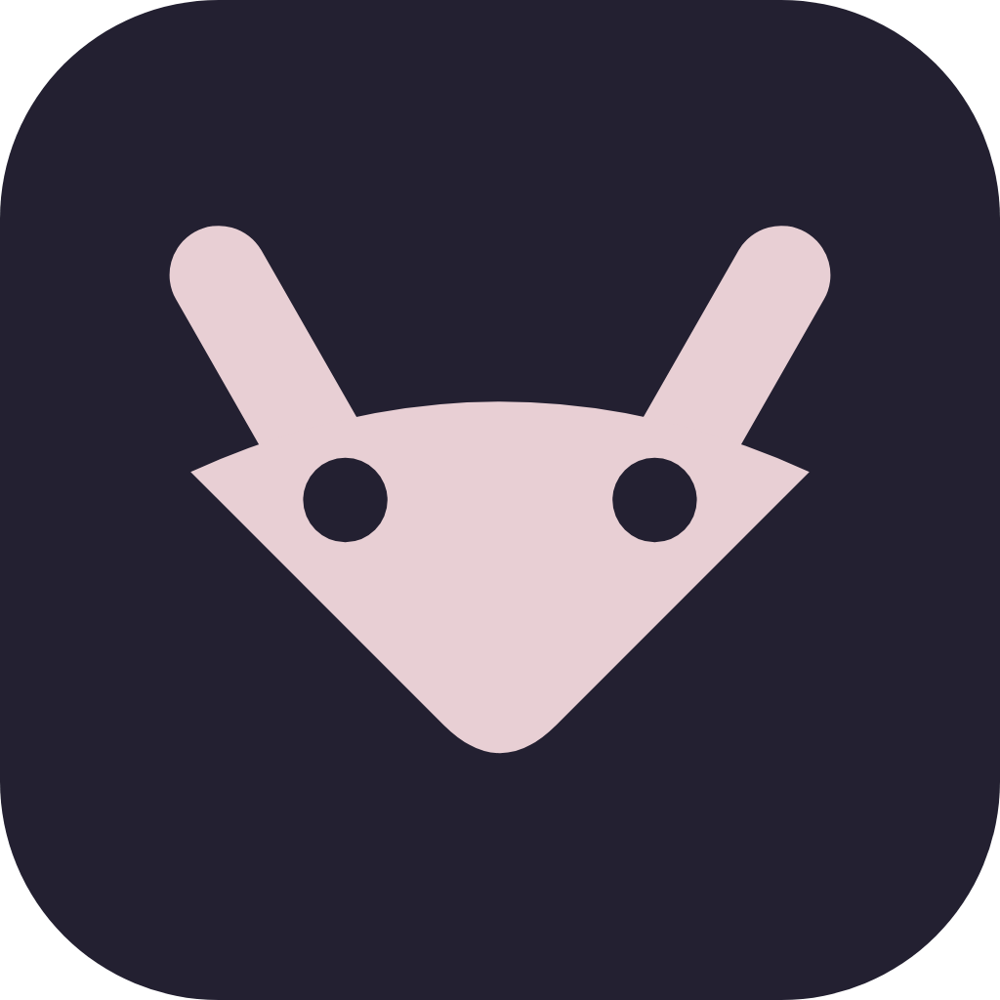
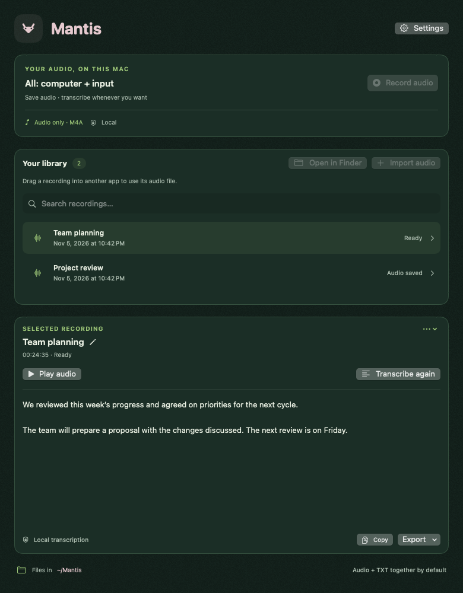

<p align="center">
  
</p>

<h1 align="center">Mantis</h1>

<p align="center">Grabación de audio para macOS, con transcripción local opcional.</p>

<p align="center">
  
  
  
  <a href="LICENSE"></a>
</p>

Mantis graba el sonido del computador, un micrófono o una aplicación específica. Guarda archivos **M4A**, organiza una biblioteca local y permite transcribir con modelos que se ejecutan en tu Mac. No requiere cuenta, backend, Handy ni FFmpeg.

**[Descargar DMG para Apple Silicon](https://github.com/Caracolaracol/mantis/releases/latest/download/Mantis-0.2.2.dmg)** · **[Releases y checksum](https://github.com/Caracolaracol/mantis/releases/latest)**

<p align="center">
  
</p>

*Vista ilustrativa renderizada con datos ficticios; no contiene reuniones reales.*

> **En desarrollo.** Distribución local con firma ad hoc, sin notarización de Apple. Las pruebas automatizadas no sustituyen la validación de permisos, dispositivos y reuniones reales. No la uses como única copia de una grabación importante sin probarla antes.

## Funciones

- **Solo audio:** computador + entrada, computador, entrada, aplicación o aplicación + entrada.
- Selección de micrófono/interfaz y canales, sin cambiar la entrada global de macOS.
- Archivos **M4A/AAC**, nombres automáticos por fecha y hora y títulos editables.
- Biblioteca con búsqueda, reproducción, importación, **Abrir en Finder** y arrastre nativo de archivos hacia otras apps.
- Transcripción local opcional mediante **transcribe.cpp 0.4.1** y modelos GGUF compatibles.
- Catálogo de modelos con descarga confirmada, progreso, cancelación y validación SHA-256.
- Audio y TXT juntos por defecto; ubicaciones configurables por separado.
- Barra de menús, inicio sin ventana, inicio de sesión opcional y control por CLI.
- Recuperación de permisos desde **Ajustes → Privacidad**.

La transcripción automática está **desactivada por defecto**. Puedes usar Mantis solo para grabar, sin descargar ningún modelo.

## Requisitos

| Para usar | Para compilar |
| --- | --- |
| macOS 15 o posterior | macOS 15 o posterior |
| Apple Silicon para los bundles distribuidos | Xcode 16 o posterior, con Swift 6 |
| Permisos de las fuentes elegidas | Herramientas de línea de comandos de Xcode |
| Modelo local solo si quieres transcribir | Internet para obtener el XCFramework fijado en `Package.swift` |

El paquete usa Swift tools 5.9 y modo de lenguaje Swift 5. Python 3 solo se necesita para las pruebas opcionales de SketchyBar.

## Compilar e instalar

### Descargar la app

Descarga el DMG desde [Releases](https://github.com/Caracolaracol/mantis/releases/latest), ábrelo y arrastra Mantis a **Aplicaciones**. Sal de cualquier versión anterior antes de reemplazarla, expulsa el DMG y abre la copia instalada. Los modelos se descargan por separado desde la app solo si quieres transcribir.

### Compilar desde el código

```bash
git clone https://github.com/Caracolaracol/mantis.git
cd mantis
CONFIGURATION=release ./scripts/build-app.sh
```

Esto crea `build/Mantis.app`, integra el motor y los avisos de terceros, y firma el bundle localmente. **No instala ni abre la app.** La primera compilación obtiene el XCFramework oficial de transcribe.cpp, fijado por versión y checksum; no descarga pesos de modelos.

Para abrirla sin instalar:

```bash
open build/Mantis.app
```

### Crear un DMG para arrastrar a Aplicaciones

```bash
./scripts/build-dmg.sh
./scripts/verify-dmg.sh build/Mantis-0.2.2.dmg
```

Se generan `build/Mantis-0.2.2.dmg` y su archivo `.sha256`. El DMG contiene Mantis y un acceso a **Aplicaciones**:

1. Sal de cualquier versión de Mantis abierta; cerrar su ventana no termina la app.
2. Abre el DMG y arrastra **Mantis.app** a **Aplicaciones**.
3. Expulsa el DMG y abre `/Applications/Mantis.app`.

Los scripts no sobrescriben un DMG existente. `verify-dmg.sh` monta la imagen solo para lectura, comprueba firma, enlace y motor, y la desmonta. Los binarios, grabaciones y modelos no se incluyen en Git.

> macOS puede bloquear una app no notarizada. Si confías en la copia que compilaste, revisa **Ajustes del Sistema → Privacidad y seguridad**. No desactives Gatekeeper globalmente.

### Firma y compilaciones aisladas

`SIGN_IDENTITY` permite elegir una identidad de firma disponible en el llavero. El valor predeterminado es firma ad hoc; los scripts **no realizan notarización**.

Para generar otro bundle sin reemplazar la app que estás usando:

```bash
MANTIS_APP_OUTPUT="$HOME/Desktop/Mantis.app" CONFIGURATION=release ./scripts/build-app.sh
MANTIS_APP="$HOME/Desktop/Mantis.app" ./scripts/build-dmg.sh build/Mantis-personal.dmg
```

La protección del empaquetador impide reemplazar el ejecutable del bundle de destino si está en ejecución.

## Primer uso

La bienvenida guía por **Audio → Carpeta → Permisos → Transcripción**. No empieza a grabar ni descarga modelos por mostrarla. Al completarla, los siguientes inicios muestran la biblioteca, salvo que elijas iniciar sin ventana.

1. Elige qué quieres grabar y la entrada que corresponde.
2. Selecciona una carpeta local; el destino predeterminado es `~/Mantis`.
3. Autoriza las fuentes necesarias en macOS.
4. Elige un modelo o continúa guardando solo audio.
5. Pulsa **Grabar audio** y detén la grabación cuando termines.

**Importar audio** crea una copia M4A en la biblioteca sin modificar el original. Para transcribir una grabación, selecciónala y pulsa **Transcribir**.

### Ajustes

Abre **Ajustes** desde la cabecera o con `⌘,`:

| Sección | Opciones |
| --- | --- |
| **General** | Iniciar en la barra de menús sin ventana y abrir al iniciar sesión en macOS. Ambas desactivadas por defecto. |
| **Grabación** | Fuentes, aplicación, micrófono/interfaz y canales. |
| **Modelos** | Catálogo, importación GGUF, descarga, modelo activo y transcripción automática. |
| **Archivos** | Ubicación de los textos y de los audios, cada una con **Cambiar carpeta**. |
| **Privacidad** | Estado de permisos, enlaces a macOS, restablecimiento del permiso de audio y repetición de la bienvenida. |

El inicio sin ventana se aplica en el próximo lanzamiento, después de completar la bienvenida. Para abrir la biblioteca, usa clic derecho en el icono de Mantis → **Abrir Mantis**. El inicio de sesión usa `SMAppService.mainApp`: actívalo desde la copia instalada en Aplicaciones y aprueba la solicitud de macOS si corresponde. Ninguna opción inicia grabaciones automáticamente.

### Barra de menús y arrastre

- **Clic izquierdo:** graba computador + entrada; otro clic detiene. Durante procesamiento abre la ventana.
- **Clic derecho:** grabar/detener, abrir Mantis, cancelar transcripción o salir.
- **Arrastrar una fila:** entrega el archivo de audio real mediante una sesión nativa de macOS, como Finder. No se pueden arrastrar capturas en curso ni archivos ausentes.

Puedes soltar un audio en una app o zona de carga compatible de Gemini/NotebookLM. La recepción depende de sus formatos y límites; esa integración aún requiere validación manual. **Al soltarlo en un servicio externo, ese servicio puede subir el archivo.**

## Permisos y solución de problemas

macOS autoriza por separado:

- **Micrófono:** para la entrada elegida, incluido un dispositivo o interfaz de audio.
- **Grabación de pantalla y audio del sistema:** para audio del computador o de una aplicación.

Mantis **no guarda imágenes ni video**. ScreenCaptureKit recibe cuadros mínimos de soporte y los descarta; los archivos publicados contienen solo audio.

### macOS muestra autorización, pero Mantis no puede grabar

Las compilaciones ad hoc cambian su identidad al cambiar el ejecutable. macOS puede conservar un interruptor activado cuyo permiso pertenece a una versión anterior.

1. Abre la copia que realmente usarás, preferentemente desde Aplicaciones.
2. Ve a **Ajustes → Privacidad → Restablecer permiso de audio…**.
3. Revisa la confirmación. El botón ejecuta únicamente:

   ```bash
   /usr/bin/tccutil reset ScreenCapture local.agus.MeetingRecorder
   ```

4. Sal de Mantis y vuelve a abrir **esa misma copia**.
5. Solicita y aprueba el acceso en macOS. Reinicia la app si el sistema lo pide.

El restablecimiento no toca micrófono, otras apps ni archivos. Se bloquea durante operaciones y no concede permisos por sí solo. No resuelve todos los fallos de audio: para evitar este problema entre versiones se necesita una **identidad de firma estable**, idealmente Developer ID de Apple.

Si una entrada de audio seleccionada desaparece o cambia de configuración, se informa el error en vez de elegir otra silenciosamente. Usa auriculares para evitar eco y verifica los canales de tu interfaz.

## Transcripción y modelos

El motor **transcribe.cpp 0.4.1** está integrado en la app. Los pesos se importan o descargan solo cuando lo confirmas; no forman parte del bundle.

| Modelo del catálogo | Tamaño aproximado |
| --- | ---: |
| Whisper Base Q8 | 85 MB |
| Whisper Small Q8 | 270 MB |
| Whisper Large v3 Turbo Q8 | 886 MB |
| Nemotron 3.5 ASR Streaming 0.6B Q8 | 751 MB |
| Granite Speech 4.1 2B Plus Q8 | 2,35 GB |

Las descargas usan revisiones fijas, tamaño esperado y SHA-256. **Descargar no cambia el modelo activo:** elige **Usar** después. Cada modelo tiene su propia licencia y requisitos; el motor verifica compatibilidad al cargarlo. No hay identificación de personas ni diarización implementada.

## Datos y privacidad

```text
~/Mantis/
  Reunión 2026-11-05 10-30.m4a
  Reunión 2026-11-05 10-30.txt
  .mantis/<UUID>/                    # metadatos y temporales internos

~/Library/Application Support/MeetingRecorder/
  Models/                           # pesos locales y selección
  Control/                          # instancia única y cola de comandos
```

- Audio y TXT comparten carpeta y nombre por defecto. Cambiar una ubicación copia los archivos correspondientes y conserva originales; no sobrescribe archivos diferentes.
- El audio final es AAC mono. Los MOV internos son temporales de solo audio y se conservan ante fallos hasta completar la conversión y persistencia.
- No hay cuenta, backend ni subida de grabaciones o transcripciones desde Mantis. Descargar modelos contacta Hugging Face y su CDN.
- Una carpeta sincronizada puede enviar datos a su proveedor. El historial interno también puede contener texto aunque separes los TXT.
- No hay cifrado adicional al disco; considera FileVault y copias de seguridad.
- Avisa a los participantes y cumple las obligaciones de consentimiento antes de grabar.

El identificador `local.agus.MeetingRecorder` y las rutas internas `MeetingRecorder` se mantienen por compatibilidad de datos y permisos.

## Desarrollo y pruebas

```bash
swift test --disable-automatic-resolution
python3 scripts/test-sketchybar.py
```

Integraciones opcionales con un modelo **ya disponible localmente**, sin descargar pesos:

```bash
MEETING_RECORDER_INTEGRATION=1 swift test --disable-automatic-resolution
```

Para renderizar vistas con datos ficticios, configura `MANTIS_UI_PREVIEW_DIR` apuntando a una carpeta temporal. No se capturan imágenes del escritorio.

La suite cubre persistencia, colisiones de archivos, recuperación, audio sintético, mezcla de canales, modelos, permisos simulados, control local, arrastre nativo e inicio de sesión con un servicio falso. **Las pruebas de restablecimiento no ejecutan `tccutil` real.**

Capturas reales, reuniones largas, próxima sesión de macOS y recepción en servicios externos requieren validación manual. El progreso y los pendientes están en [PLAN.md](PLAN.md).

### Estructura

```text
Sources/MeetingCore/          # persistencia, modelos, normalización y motor
Sources/MeetingRecorder/      # SwiftUI/AppKit, captura, permisos y barra de menús
Tests/                       # pruebas de núcleo, captura e interfaz
Resources/                   # iconos, Info.plist y avisos de terceros
scripts/                     # compilación, DMG, verificación y SketchyBar opcional
design/                      # exploraciones visuales de la marca
```

### CLI y SketchyBar opcional

```bash
build/Mantis.app/Contents/MacOS/MeetingRecorder --status
build/Mantis.app/Contents/MacOS/MeetingRecorder --show
# Estas acciones sí inician/detienen operaciones:
build/Mantis.app/Contents/MacOS/MeetingRecorder --toggle-recording
build/Mantis.app/Contents/MacOS/MeetingRecorder --stop-recording
build/Mantis.app/Contents/MacOS/MeetingRecorder --cancel-transcription
```

La CLI usa una sola instancia y una cola privada de comandos con caducidad, sin abrir puertos. La integración opcional está en `scripts/sketchybar-recorder.sh`; configura `MEETING_RECORDER_APP` con la ruta de tu app. SketchyBar no es necesario para usar Mantis.

## Créditos

Mantis utiliza [transcribe.cpp](https://github.com/handy-computer/transcribe.cpp), del proyecto [handy-computer](https://github.com/handy-computer), como motor de transcripción local. Gracias a sus autores y a las comunidades de ggml, Silero VAD y miniz, cuyas licencias y avisos se conservan en [Resources/ThirdParty](Resources/ThirdParty/).

Mantis es un proyecto independiente: **no requiere tener Handy instalado ni implica afiliación o respaldo por parte de Handy**. Los modelos de transcripción pertenecen a sus respectivos autores y mantienen sus propias licencias.

## Estado y licencias

No hay transcripción en vivo, diarización, identificación de personas, resúmenes, pausa ni actualizaciones automáticas. La app no está sandboxeada ni preparada para App Store. Una interrupción abrupta no garantiza recuperar todo el audio.

El código propio de Mantis es **software de código abierto bajo la [licencia MIT](LICENSE)**: puedes usarlo, modificarlo y redistribuirlo, incluso comercialmente, conservando el aviso de autoría y la licencia.

Los avisos del motor y sus dependencias están en [Resources/ThirdParty](Resources/ThirdParty/); sus licencias se conservan por separado. Los modelos se rigen por sus propias licencias y no se redistribuyen aquí.
